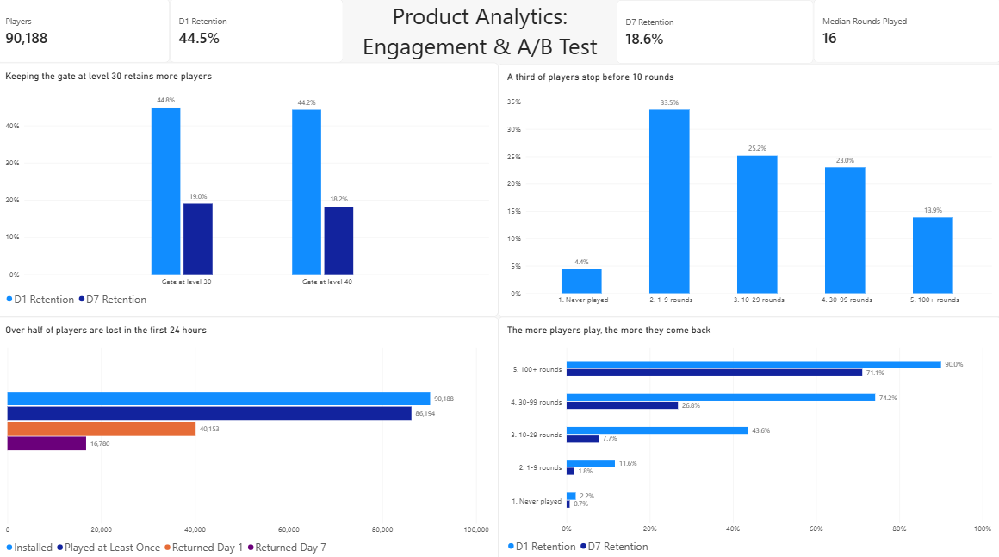

# Product Analytics: Player Engagement, Retention & A/B Test

**Tools:** SQL (SQLite), Power BI

**Author:** Merdi Mayindu

## Business problem

In the mobile game **Cookie Cats**, players hit a "gate" at certain levels where they must wait or pay to keep playing. The product team ran an **A/B test** moving the first gate from **level 30 to level 40**.

This project uses SQL to answer two questions:
1. **How engaged are players, and where do they drop off?**
2. **Did moving the gate help or hurt player retention?**

## Dataset

[Cookie Cats mobile game A/B test](https://www.kaggle.com/datasets/yufengsui/mobile-games-ab-testing) (Kaggle): 90,189 players who installed the game during the test, with their version (gate at level 30 or 40), game rounds played in the first 14 days, and whether they came back 1 day and 7 days after installing.

## Key metrics

| Metric | Meaning |
|---|---|
| D1 retention | % of players who came back and played 1 day after installing |
| D7 retention | % of players who came back and played 7 days after installing |
| Game rounds | Rounds played in the first 14 days |

## Data checks and cleaning

- Confirmed **90,189 unique players** with an **even 50/50 split** between versions, as a fair A/B test needs
- **Retention stored as text** ("True" / "False") was converted to 1/0 flags
- **Removed 1 extreme outlier:** a player recording 49,854 rounds in 14 days (over 3,500 a day), almost certainly a tracking error or bot
- **Kept the 3,994 players (4.4%) who never played**, since failing to start is a real product problem
- Grouped players into **5 engagement bands** by rounds played

## Key findings

### Engagement and retention

| Area | Finding |
|---|---|
| Retention | **44.5%** came back on day 1, but only **18.6%** on day 7 |
| Typical player | **Median 16 rounds** vs an average of 51. A few heavy players inflate the average |
| Day-1 effect | Players who returned on day 1 were **4.5x** more likely to still be playing on day 7 (32.8% vs 7.2%) |
| Engagement | A third of players stopped before 10 rounds, and only **1.8%** of them were still playing on day 7. Players with 100+ rounds: **71.1%** |

### Player funnel

| Stage | Players | % of installs |
|---|---|---|
| Installed | 90,188 | 100% |
| Played at least 1 round | 86,194 | 95.6% |
| Came back on day 1 | 40,153 | 44.5% |
| Came back on day 7 | 16,780 | 18.6% |

### A/B test result

| Version | Players | D1 retention | D7 retention |
|---|---|---|---|
| **Gate at level 30** | 44,699 | **44.82%** | **19.02%** |
| Gate at level 40 | 45,489 | 44.23% | 18.20% |

- Moving the gate to level 40 **lowered D7 retention by 0.82 points**, around **372 fewer players** still playing after a week
- A two-proportion z-test shows the **D7 difference is statistically significant (p = 0.002)**. The D1 difference is not (p = 0.07).
- Both versions played the same number of rounds on average (51.3), so the gate affected **whether players came back**, not how much they played
- The gap was biggest among players who played 10–99 rounds, the ones most likely to reach the gate

## Recommendations

1. **Keep the gate at level 30.** Moving it lowered 7-day retention significantly.
2. **Focus on the first 24 hours.** Day-1 returners are 4.5x more likely to stick around, so improve onboarding and day-1 reminders.
3. **Get light players past 10 rounds** with easier early levels or a starter reward.
4. **Re-engage players who skip day 1** with a reminder or free lives.
5. **Report median as well as average engagement,** since heavy players skew the average.

## Dashboard

## Files

| File | Description |
|---|---|
| `product_analysis.sql` | All SQL queries, with the business question and finding for each |
| `product_dashboard.pbix` | Power BI dashboard |
| `dashboard.png` | Dashboard screenshot |
